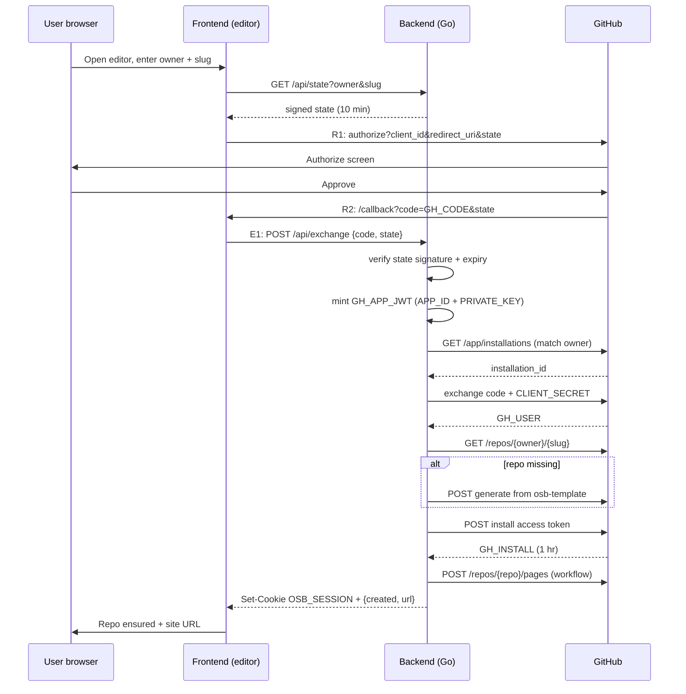
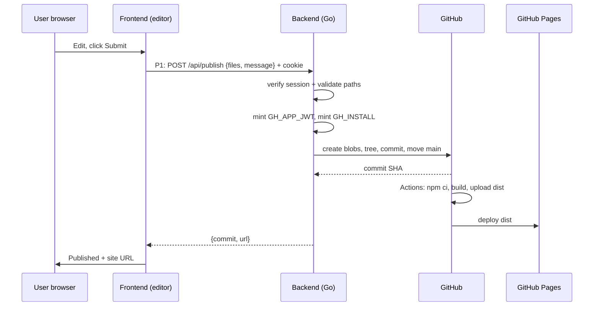
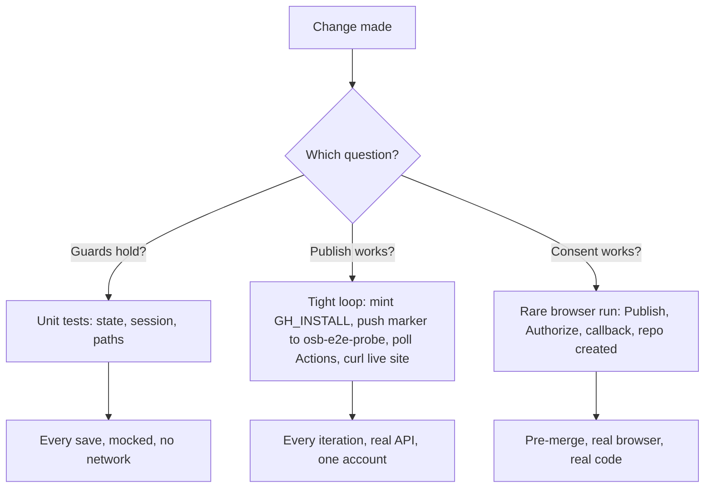

# OpenSiteBuilder Publishing Walkthrough

A linear account of what was built and proven. No detours recorded.

## 1. The idea

OpenSiteBuilder lets non-technical users publish React sites to GitHub Pages. The user edits in a visual editor. The platform creates a repository in the user's own GitHub account, pushes React source, and GitHub Actions builds and serves the site. The user never touches a terminal.

Three facts shape every decision below:

- The repository lives in the **user's** account, so the public URL reads `https://<user>.github.io/<slug>/`.
- The repository stores **source code**, never build output. Actions runs `npm run build` and serves `dist/`.
- The browser never holds GitHub credentials. A small backend holds them and enforces what the frontend may do.

## 2. Vocabulary

Five tokens exist. Only the backend ever holds GitHub tokens. The frontend holds one session cookie.

- `GH_CODE` is the consent receipt. GitHub issues it after the user clicks Authorize. It lives ten minutes, works once, and does nothing by itself.
- `GH_USER` acts as the user. The backend trades `GH_CODE` plus `CLIENT_SECRET` for it. Its single job is checking and creating repositories.
- `GH_APP_JWT` proves the backend is OpenSiteBuilder. The backend signs it locally with `PRIVATE_KEY`. It lives ten minutes and never leaves the backend.
- `GH_INSTALL` acts on one installation. GitHub issues it when the backend presents `GH_APP_JWT` plus an `installation_id`. It lives one hour and performs pushes and Pages setup. It never leaves the backend.
- `OSB_SESSION` is the platform's own cookie between frontend and backend. It binds an owner, a slug, and an installation. It is the only thing the browser stores.

Five moves use fixed names:

- `R1` sends the user from the editor to GitHub.
- `R2` returns the user to `/callback` with `GH_CODE` and `state`.
- `E1` sends `GH_CODE` and `state` from the frontend to the backend.
- `G1` checks or creates the repository and enables Pages.
- `P1` publishes site files through the backend.

Two backend secrets make this work, and each serves a different GitHub door:

- `CLIENT_SECRET` proves the platform to the OAuth endpoint. It converts consent (`GH_CODE`) into user power (`GH_USER`).
- `PRIVATE_KEY` proves the platform to the App endpoint. It signs `GH_APP_JWT`, which converts installation identity into push power (`GH_INSTALL`).

## 3. GitHub setup

Setup happened once, in the GitHub web interface, before any code ran.

### 3.1 Template repository

Repository `zacharyLYH/osb-template` was created as a public template repository. It holds a minimal Vite plus React plus Tailwind site: `package.json` with a `build` script, `vite.config.js` with `base: './'` so assets resolve under any `<owner>.github.io/<repo>/` path, `index.html`, `src/App.jsx`, and `src/main.jsx`. It holds one workflow file, `.github/workflows/deploy.yml`, which runs `npm ci`, runs `npm run build` on Node 26, uploads `dist/`, and deploys through `deploy-pages`. Every user site starts life as a copy of this repository.

### 3.2 GitHub App

GitHub App `opensitebuilder-bytesbylyh-dev` was registered with four repository permissions, each there for one reason:

- Contents read/write pushes site files.
- Pages read/write enables Pages and reads build status.
- Administration read/write creates repositories from the template. Without it, generation fails with `Resource not accessible by integration`.
- Metadata read-only is mandatory and GitHub selects it automatically.

Two URLs were saved, both pointing at `/callback`:

- Callback URL receives OAuth consent (`GH_CODE`). Saved value is the production domain; localhost was added for local runs.
- Setup URL receives installation events (`installation_id`). Same path handles both query shapes.

Beyond registration, one checkbox mattered: **Request user authorization (OAuth) during installation**. Without it, the authorize endpoint has no grant flow.

### 3.3 Installation

The App was installed once on account `zacharyLYH` with **All repositories** selected. All-repositories avoids a chicken-egg problem: the site repository does not exist at install time, so installing on a single named repo would force two redirects. The install carries ID `168937642` and stays valid indefinitely.

### 3.4 Secrets

Three values stay on the developer machine and never enter git:

- `CLIENT_SECRET` lives in `.env`.
- The private key lives in `secrets/dev.pem` with mode `600`. The backend reads it through `PRIVATE_KEY_PATH`. A file preserves PEM newlines better than an inline variable.
- `SESSION_HMAC_KEY` is 32 random bytes in `.env`. It signs `state` and `OSB_SESSION`.

Everything else is ordinary configuration and safe to record: `APP_ID 5226393`, `CLIENT_ID Iv23liBOHhapv9XPFgLw`, `APP_SLUG opensitebuilder-bytesbylyh-dev`, template `zacharyLYH/osb-template`, test owner and installation above. One `.env` serves development and production. Only `PUBLIC_BASE_URL` differs per environment and compose overrides it.

## 4. Runtime architecture

One domain serves everything. Production domain is `https://opensitebuilder.bytesbylyh.dev`. Development origin is `http://localhost:9999`. The host already runs other projects on ports `5173` and `8080`, so this project avoids both.

Three containers run behind edge nginx:

- `edge` is the only container with a host port (`9999:80`). It routes `/` and `/callback` to the frontend, `/api/*` and `/healthz` to the backend. One origin means no browser CORS work.
- `frontend` serves the Vite React build with Tailwind and shadcn components. It listens on internal port `80` and exposes nothing to the host.
- `backend` is one Go binary listening on internal port `18081`. It exposes nothing to the host and never uses `8080`.

Pinned versions are Go `1.26`, Node `26.5`, and React `19.3`.

## 5. The proven user journey

This exact sequence ran end to end and created repository `zacharyLYH/osb-e2e-probe` with Pages enabled.

### Step 1: anonymous editing

The user opens the editor with no login. The user types an owner and a slug, for example `zacharyLYH` and `osb-e2e-probe`, and sees the future URL `https://zacharyLYH.github.io/osb-e2e-probe/`. No repository exists yet.

### Step 2: `R1`, state then GitHub

The user clicks Publish. The frontend calls `GET /api/state?owner=...&slug=...`. The backend validates the names against strict patterns and returns a signed `state` token binding owner, slug, and a ten-minute expiry. The frontend redirects to `github.com/login/oauth/authorize` with the platform's `CLIENT_ID`, a `redirect_uri` back to `/callback`, and that `state`. The `state` value later proves the callback belongs to the request the backend signed, which blocks cross-site forgery.

### Step 3: consent on GitHub

GitHub shows the Authorize screen because the App requested OAuth authorization. The user approves. GitHub redirects to `/callback?code=GH_CODE&state=...`. The receipt proves this user consented in this moment.

### Step 4: `R2`, the callback page

The `/callback` route reads `code` and `state` from the URL and posts them to `POST /api/exchange`. It shows progress, then the result: repository, whether it was created, and the site URL.

### Step 5: `E1` plus `G1`, the backend exchange

The backend runs six operations in an order chosen so no single-use value burns on a recoverable branch:

1. Verify `state` signature and expiry. Cheap checks run before any GitHub call.
2. Mint `GH_APP_JWT` from `APP_ID` and `PRIVATE_KEY`.
3. Resolve the installation. With no install ID supplied, the backend lists installations and matches `account.login` against the state owner. Match `zacharyLYH` resolves to install `168937642`. No match returns `409` with an install link instead of failing later.
4. Exchange `GH_CODE` plus `CLIENT_SECRET` for `GH_USER`.
5. Check `GET /repos/{owner}/{slug}` with `GH_USER`. A `404` response means the name is free, so the backend calls the generate endpoint against `osb-template` with `private: false`. This call is the reason Administration permission exists.
6. Mint `GH_INSTALL` for the install, call `POST /repos/{owner}/{repo}/pages` with `build_type: workflow` (`409` means already enabled and is fine), then issue `OSB_SESSION` as an `HttpOnly` cookie and return `{owner, slug, created, url}`.

The proven run returned `created: true` for `zacharyLYH/osb-e2e-probe`.

### Step 6: `P1`, publishing

Inside the editor, Submit posts `{files, message}` with the session cookie to `POST /api/publish`. The backend verifies the session matches the site, validates every path against an allowlist (`src/`, `public/`, `index.html`, `package.json`, config files; `.github/` and `.git/` always rejected; 20 files and 200 KB per file caps), then commits through the Git Data API with `GH_INSTALL`: create blobs, create a tree on the `main` tip, create a commit, move the branch reference. Actions builds `dist/` and deploys automatically.

### Step 7: return visits

The user supplies owner and slug. The backend mints a fresh `GH_INSTALL` from the install recorded in the session, pulls `src/*` through the allowlist, and loads the editor. No GitHub redirect occurs unless the App was uninstalled.

## 6. Testing strategy

Two flows exist because two different questions need answers, and each runs at its own cadence.

- **Install plus creation flow** (`R1/R2/E1/G1`) answers whether consent, exchange, generation, and Pages setup work. It needs a real browser and real credentials, so it runs rarely: pre-merge or nightly. The proven run above was this test.
- **Push flow** (`G1` presence plus `P1`) answers whether publishing and deployment work. It mints `GH_INSTALL` directly from the stored installation ID and pushes to the fixed probe repository `osb-e2e-probe`. No browser runs, no new accounts exist, no `GH_CODE` is needed because presence checks and pushes both accept `GH_INSTALL` after the repository exists. Script `scripts/publish-probe.mjs` performs this loop: mint, push a marker commit, poll the Actions run for the commit SHA, poll the live site until the marker appears.
- **Unit tests** answer whether guards hold without any network. The Go suite covers state and session round-trips, expiry, wrong-key rejection, and the full path allowlist table. They run on every change.

## 7. What was proven

- Secrets and tokens verified live: key validity through `openssl`, App identity through `GET /app`, install scope through the installation lookup, client secret through a rejected fake code.
- The full consent journey ran in a browser and created `zacharyLYH/osb-e2e-probe` from template with Pages enabled, returning `created: true`.
- The compose stack serves the editor at `localhost:9999` with health at `/healthz`.
- `osb-template` on `main` holds the Vite React 19 Tailwind probe plus the Pages workflow on Node 26.

## 8. Flow diagrams

